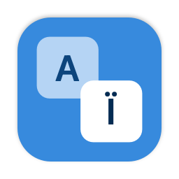
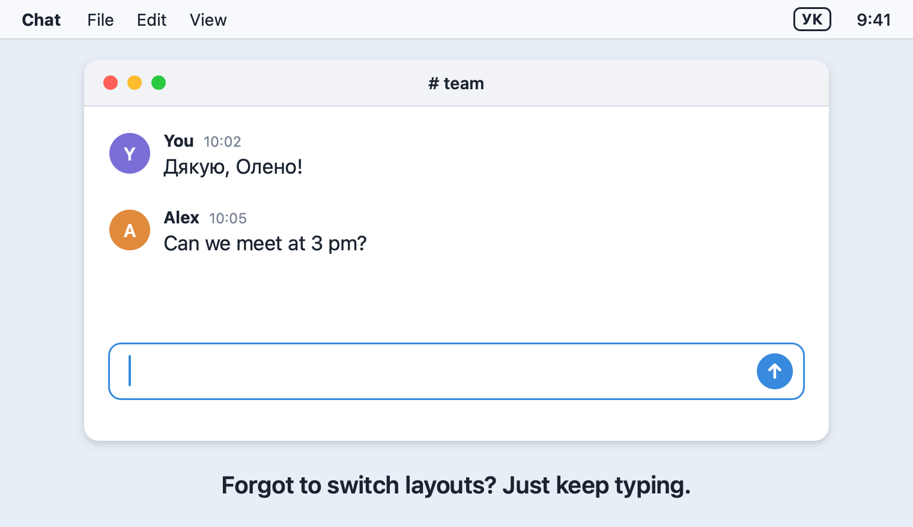
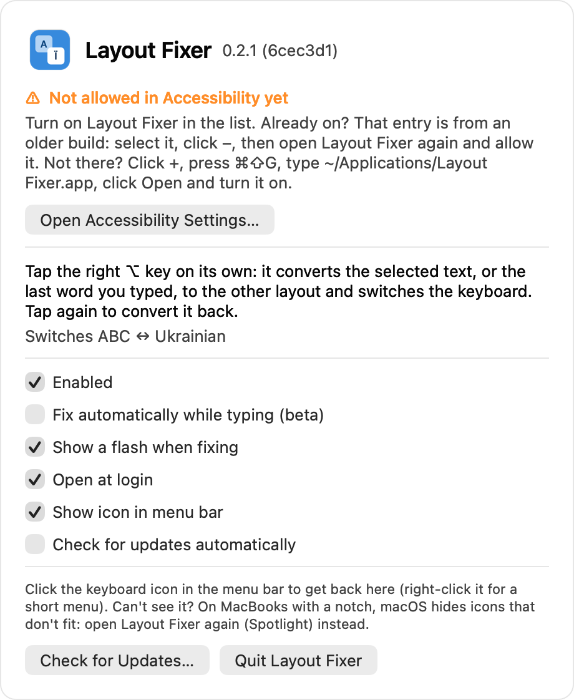

# Layout Fixer

Typed a whole sentence before noticing the keyboard was on the wrong language? Select it and tap the **right ⌥**
key: Layout Fixer retypes it on the right layout and switches the keyboard for you.

`ghbdsn` → `привіт` · `руддщ` → `hello` · works between English and your language (Ukrainian, Polish, Greek,
Bulgarian, Hebrew, German, …).

A small menu bar app for macOS 13 or newer, on Apple silicon or Intel. Free and open source.



## Install

1. Open **Terminal** (press ⌘Space, type `Terminal`, press Return).
2. Paste this line and press Return:

   ```bash
   curl -fsSL https://raw.githubusercontent.com/m-ilchuk/layout-fixer/main/get.sh | bash
   ```

   It downloads the latest release, builds it on your Mac (under a minute; updates take seconds) and starts it. Building needs Apple's
   free command line tools: if they're missing, a window offers to install them. Click **Install**, wait for it to
   finish, then paste the line again.
3. **Allow it.** The Layout Fixer window opens, and a dialog says *"Layout Fixer" would like to control this
   computer using accessibility features*. Click **Open System Settings** and turn on **Layout Fixer**. macOS may
   ask for your password or Touch ID.

   No dialog, or Layout Fixer isn't in the list? Open System Settings › Privacy & Security › **Accessibility**, click
   **+**, press ⌘⇧G, type `~/Applications/Layout Fixer.app`, press Return, click **Open** and turn it on.
4. Within a few seconds the window says **✓ Allowed in Accessibility** and the menu bar icon changes from ⚠ to ⌨.
   Done.

Optional: in the same window, turn on **Open at login** to start it with your Mac.

## Use

**Tap the right ⌥ key** on its own (press and release it, nothing else):

| | One tap | Tap again |
|---|---|---|
| **Text selected** | Converts it to the other layout; it stays selected | Puts back exactly what was there |
| **Nothing selected** | Converts the last word you typed | Flips it back |

The keyboard layout switches with it, and a small badge such as `UK → EN` shows under the text cursor for a moment.

Try it (with Ukrainian): switch to English, type `ghbdsn`, tap right ⌥. You get `привіт` and the keyboard is
now Ukrainian. Tap again and it's back to `ghbdsn`.

## Settings

Click the ⌨ icon in the menu bar, or open **Layout Fixer** again (Spotlight or `~/Applications`), to get its window.
Right-click the icon for a short menu: **Enabled**, **Settings…** and **Quit**.



In the window:

- **Switches ABC ↔ Ukrainian**: the two layouts it uses now.
- **Enabled**: pause it without quitting.
- **Fix automatically while typing (beta)**, off by default: when you finish a word with Space and it only makes
  sense on the other layout (checked with the macOS dictionaries, typos allowed), it is retyped without a tap,
  together with the words before it typed on the same wrong layout: `рун умукщту рщц` → `hey everone how`.
- **Show a flash when fixing**: the `UK → EN` badge.
- **Open at login**.
- **Show icon in menu bar**: macOS already shows the current layout, so the icon can go; the window is always
  there when you open Layout Fixer again. While it waits for Accessibility it shows ⚠ even when hidden.
- **Check for Updates…** and **Check for updates automatically** (once a day).

**Statistics** (at the top of the window): words fixed while typing, converted with right ⌥, and automatic fixes
you undid right after, for today, the last 7 days and all time, and the share of automatic fixes you kept.

**Exclusions**: words fix-while-typing leaves as you typed them. Undo a fix right after it (tap right ⌥, press ⌘Z,
or erase the word and type it again on the layout you meant) and that word stays this time; undo the same word 3
times (`csv`, which would turn into `сім`) and it's added here for good. **Add…** a word yourself, or **Remove**
one to let it be fixed again. Right ⌥ still converts them.

## Layouts

It uses the keyboard layouts you have turned on in System Settings › Keyboard › Text Input › Input Sources, and
reads each layout's keys from macOS, so any language works without setup. You need English (ABC or U.S.) and your
language. Text on your language goes to English, and English goes to your language. With several languages turned
on (say Ukrainian and Polish), English goes to the one you used last.

Fix-while-typing uses the macOS dictionaries (40+ languages, including uk, pl, bg, el, he, de, fr, cs). For a
language without one it only fixes words that should be English; the right ⌥ key works for every language.

## Update

When a new version is out, the window's update button (and the right-click menu) says **Install version X.Y.Z…**.
Click it, read what's new and click
**Install**: it downloads, builds and restarts by itself in about a minute (the icon shows ⟳ meanwhile).

Updates keep the Accessibility permission. Only when you update from 0.2.1 or earlier, allow it once more: in
Privacy & Security › **Accessibility**, select Layout Fixer (or the older LayoutFixer), remove it with **–**, then
open Layout Fixer and allow it when asked.

You can also update by running the install line again.

## Troubleshooting

- **I can't see the icon in the menu bar.** On MacBooks with a notch, macOS hides menu bar icons that don't fit
  next to it. Open Layout Fixer again from Spotlight to get its window, or make room: hold ⌘ and drag icons you
  don't need off the menu bar.
- **Nothing happens when I tap right ⌥.** Open Layout Fixer again: its window says whether it is allowed in
  Accessibility (see Install, step 3) and whether it is **Enabled**. Tap the key quickly and on its own: holding it, or pressing another key
  with it, is ⌥ doing its usual job.
- **It beeps.** Nothing is selected and you haven't typed anything since your last click, so there is nothing to
  convert.
- **It's switched on in Accessibility, but the window still shows ⚠** (after updating from 0.2.1 or earlier). That
  entry belongs to the old build: select it, remove it with **–**, then open Layout Fixer and allow it when asked.
- **Wrong text in a browser or chat app.** Some apps don't tell macOS what is selected. Layout Fixer then copies the
  selection, converts it and pastes it back (your clipboard is restored after). Tap once and wait half a second
  before tapping again.
- **It converts to the wrong language.** Check the **Switches …** line in the window. If it isn't your pair, turn the right
  layouts on in Input Sources. With several languages, switch to yours once: English goes to the last one you used.
- **Something didn't convert, and you'd like to know why.** Click **Export Debug Log…** in the window (or right-click
  the menu bar icon) and send the file to whoever helps you. It lists each tap and, for fix-while-typing, why a word
  was left as typed (for example "it reads as a real word where it was typed", or "memory last cleared by a
  click"). It never contains your text: only counts, layouts and reasons.
- **What is it doing?** Its log shows each tap, without your text:

  ```bash
  /usr/bin/log stream --info --predicate 'subsystem == "io.github.m-ilchuk.layoutfixer"'
  ```

## Uninstall

Quit it (right-click the ⌨ icon › **Quit Layout Fixer**, or **Quit** in the window), delete `~/Applications/Layout Fixer.app`, and remove Layout Fixer from Privacy & Security ›
Accessibility with **–**.

## Privacy

Layout Fixer needs Accessibility to read the keys you press and the text you select, and to type the converted text.
It keeps the keys only in memory (at most 300, cleared on every click, Enter or app switch), and the words it asked
the spell checker about until you switch apps. Nothing is kept or fixed in password fields. The only words it writes
down are the ones on its Exclusions list, in its settings on this Mac (a word whose fix you undid fewer than 3 times
is only kept in memory); statistics are counts only, and the debug log never contains your text. Its network calls
are the update check to GitHub (`api.github.com`), which sends nothing about you (**Check for updates
automatically** turns it off), and, when you install or update, downloading the release's installer and source
from GitHub (`raw.githubusercontent.com`, `github.com`). All of its code is in [`Sources/`](Sources).

So that updates keep the Accessibility permission, macOS recognises Layout Fixer by its identifier
(`io.github.m-ilchuk.layoutfixer`) rather than by one build's fingerprint. The trade-off: a program already on your
Mac that took the same identifier would get the same permission. A local certificate (see Develop below) ties it to
builds signed with that certificate instead; that keeps out programs from elsewhere, but not a program already
running as you, which can sign with your certificate too. Only a build signed and notarized by a registered
developer would close that.

## How it works

- **The last word:** it remembers the keys you pressed since your last click, not the characters. Converting deletes
  the word and types the same keys on the other layout. The key maps come from macOS (`UCKeyTranslate`), so nothing
  is hard-coded and the result matches your layouts (`'` → `є`, `s` → `і`, `]` → `ї`).
- **Selected text** has no key presses to replay: it reads the selection through Accessibility (or copies it where an
  app doesn't share it), works out which layout can type it, pastes the converted text over it and selects it
  again. Punctuation converts by key like letters (`руддщ,` → `hello?`, since that key types `?` in English),
  and a second tap restores the exact original.
- **Installing from source** means nothing prebuilt is downloaded, so Gatekeeper has nothing to block, and you can
  read every line that runs.

## Develop

```bash
git clone https://github.com/m-ilchuk/layout-fixer.git && cd layout-fixer
./build.sh --test   # tests (uses layouts macOS ships, so any Mac can run them)
./install.sh        # build for this Mac's chip, copy to ~/Applications, start
LAYOUT_FIXER_UNIVERSAL=1 ./build.sh   # one app for Apple silicon and Intel, to hand to anyone
```

### Testing

`./build.sh --test` runs everything that needs no permissions, on any Mac:

- **Unit tests:** conversions for every key on every layer (Ukrainian, Russian, Greek, German against English),
  selection round trips, fix-while-typing decisions, release notes, versions.
- **Chains:** whole sentences typed on a simulated Mac, the way a person types who forgot to switch. The simulated
  Mac reproduces what real Macs did: macOS reporting the old layout for a moment after a switch, and key events
  carrying the old layout's character. Each chain runs five ways.
- **Corpus** (`Tests/Corpus.swift`): about 100 everyday and work sentences in Ukrainian, English and both mixed.
  Typed on the right layout, every one must come out untouched (Layout Fixer must never change correct text).
  Typed without ever switching, every one must come out as meant, except a short, named list of known limits:
  words no dictionary knows (`Jira`, `Datadog`, `hotfix`, `CI`, slang), which a right ⌥ tap fixes.

`./e2e.sh` is the end-to-end test: it types corpus sentences into TextEdit with real key presses while the real
Layout Fixer runs, one document per scenario and a line per sentence, and checks what TextEdit shows
(`./e2e.sh all` for every sentence). It closes the documents without saving and quits TextEdit when it's done;
the scores and misses go to `build/e2e-report.txt`. Run it from Terminal.app with TextEdit closed: it turns TextEdit's own autocorrect off for
the run (so only Layout Fixer's fixes count) and back on after. It needs Accessibility for
Terminal, asks once to control TextEdit, and takes over the keyboard for a few minutes.

### Keep permissions across rebuilds

Builds without a certificate are recognised by their identifier, so they keep the permission (see Privacy). To tie it
to builds signed by you instead, make a local certificate (once, about a minute):

1. Keychain Access › menu **Keychain Access › Certificate Assistant › Create a Certificate…**
2. Name `LayoutFixer Local Signing`, Identity Type **Self-Signed Root**, Certificate Type **Code Signing** › Create.
3. In the **login** keychain, double-click the new certificate › **Trust** › Code Signing: **Always Trust**.
4. `./install.sh` (it prints `signed with LayoutFixer Local Signing`), then allow Layout Fixer one last time.

`build.sh` uses the certificate whenever it finds it, and signs ad-hoc otherwise (`LAYOUT_FIXER_ADHOC=1` forces
ad-hoc, to test that path).

### Release

Versions follow [semantic versioning](https://semver.org): **MAJOR** when something people rely on changes or goes
away (a key, a setting), **MINOR** for new features, **PATCH** for fixes. Before 1.0.0, breaking changes bump MINOR.

```bash
./release.sh 0.2.0
```

Write what changed under **Unreleased** in [`CHANGELOG.md`](CHANGELOG.md) as you go, for people: the update dialog
shows it (`## headings`, `- bullets`, `**bold**`, `` `code` ``; wrapped lines are joined). `release.sh` checks that
`main` is clean and pushed and that Unreleased isn't empty, runs the tests, sets the version in `Info.plist`, turns
Unreleased into the version's section, commits, tags `v0.2.0`, pushes, and creates the GitHub Release with that
section as its notes. Installed copies offer it within a day; the install line installs it from then on. To try
unreleased code, put `LAYOUT_FIXER_REF=main` before `bash` in the install line.
